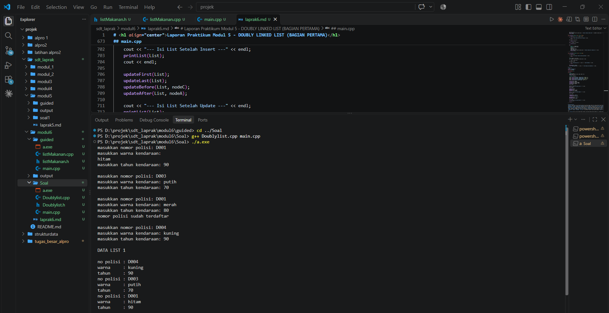
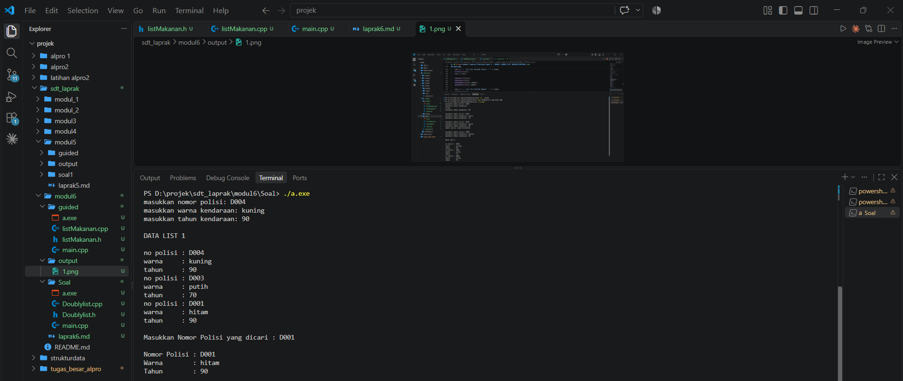
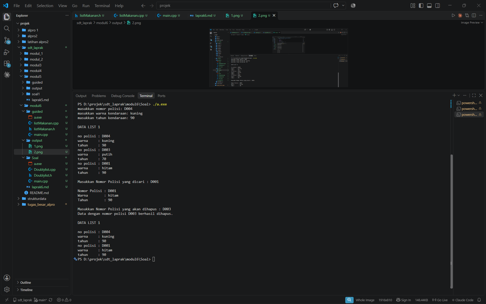

# <h1 align="center">Laporan Praktikum Modul 6 - DOUBLY LINKED LIST (BAGIAN PERTAMA)</h1>

<p align="center">Hassan Donny Darmawan - 109082500030</p>

## Dasar Teori

Bagian ini membahas konsep dasar yang digunakan dalam praktikum, mulai dari pengertian *doubly linked list*, struktur ADT *doubly linked list* dalam file `.h` dan `.cpp`, hingga operasi-operasi dasar seperti penambahan elemen, penghapusan elemen, serta *update*, *view*, dan *searching*.

---

### A. Doubly Linked List<br/>

Sub-bagian ini membahas pengertian *doubly linked list*, komponen penyusunnya, dan cara deklarasi struktur datanya.

#### 1. Pengertian Doubly Linked List

*Doubly linked list* adalah *linked list* yang setiap elemennya memiliki dua *successor*, yaitu *successor* yang menunjuk ke elemen sebelumnya (`prev`) dan *successor* yang menunjuk ke elemen sesudahnya (`next`). Karena setiap elemen saling terhubung ke dua arah, *list* dapat ditelusuri secara maju maupun mundur. Pada kondisi kosong, `first` dan `last` sama-sama bernilai `Nil`. Pada *list* yang berisi elemen, `prev` milik elemen pertama dan `next` milik elemen terakhir bernilai `Nil`.

#### 2. Komponen Doubly Linked List

*Doubly linked list* menggunakan dua *successor* utama pada *list* dan dua *successor* pada setiap elemen, yaitu:
- `First`, yaitu *pointer* pada *list* yang menunjuk ke elemen pertama *list*.
- `Last`, yaitu *pointer* pada *list* yang menunjuk ke elemen terakhir *list*.
- `Next`, yaitu *pointer* pada elemen sebagai *successor* yang menunjuk ke elemen di depannya.
- `Prev`, yaitu *pointer* pada elemen sebagai *successor* yang menunjuk ke elemen di belakangnya.

#### 3. Deklarasi Struktur Data

Struktur data *doubly linked list* dideklarasikan dengan `typedef` untuk tipe data informasi (`infotype`) dan `typedef struct elmlist *address;` agar `address` menjadi *pointer* ke `elmlist`. Kemudian dibuat `struct elmlist` yang berisi `info` bertipe `infotype` serta dua *pointer* bertipe `address`, yaitu `next` dan `prev`, dan `struct list` yang berisi `address first` dan `address last`. Konstanta `Nil` didefinisikan sebagai `NULL`, dan deklarasi dilengkapi dengan `#ifndef`, `#define`, dan `#endif` agar file *header* tidak ter-*include* berulang kali.

### B. ADT Doubly Linked List<br/>

Sub-bagian ini membahas cara fungsi dasar *doubly linked list* disusun sebagai ADT dalam file `.h` dan `.cpp`.

#### 1. Pembagian File ADT

Seperti pada *singly linked list*, semua fungsi dasar pada *doubly linked list* merupakan bagian dari ADT. Pada bahasa pemrograman C++, ADT tersebut disimpan dalam dua jenis file, yaitu file `*.h` yang berisi deklarasi tipe data dan *prototype* fungsi, serta file `*.cpp` yang berisi realisasi dari fungsi-fungsi tersebut. Fungsi `main()` ditulis pada file terpisah, yaitu `main.cpp`.

#### 2. Aturan Dasar List

Sebuah *list* dinyatakan kosong jika `L.first = Nil`. Setiap elemen dengan alamat `P` dapat diacu dengan `P->info` untuk mengakses data, `P->next` untuk mengakses elemen berikutnya, dan `P->prev` untuk mengakses elemen sebelumnya. Elemen terakhir *list* ditunjuk oleh `L.last`.

#### 3. Fungsi Dasar List

Fungsi dasar yang digunakan untuk mengelola *list* adalah:
- `CreateList(L)`, yaitu prosedur yang membentuk *list* kosong dengan mengisi `first` dan `last` dengan `Nil`.
- `alokasi(x)`, yaitu fungsi yang membuat elemen baru berisi `x` dan mengembalikan alamatnya, dengan `next` dan `prev` bernilai `Nil`.
- `dealokasi(P)`, yaitu prosedur yang mengembalikan memori yang digunakan `P` ke sistem.
- `printInfo(L)`, yaitu prosedur yang menampilkan seluruh isi *list*.

### C. Penambahan Elemen (Insert)<br/>

Sub-bagian ini membahas prosedur untuk menyisipkan elemen baru ke dalam *list*. Pada semua prosedur *insert*, elemen `P` harus sudah dialokasikan sebelum disisipkan, yaitu dengan `P = alokasi(X);` lalu `P->next = Nil;` dan `P->prev = Nil;`.

#### 1. Insert First

`insertFirst(L, P)` menempatkan elemen beralamat `P` pada awal *list*. Langkahnya adalah:
- `P->next = L.first;`, yaitu `next` elemen baru diarahkan ke elemen pertama yang lama.
- `(L.first)->prev = P;`, yaitu `prev` elemen pertama yang lama diarahkan ke elemen baru.
- `L.first = P;`, yaitu `first` dipindahkan ke elemen baru.

Jika *list* masih kosong, `first` dan `last` langsung diarahkan ke `P`.

#### 2. Insert Last

`insertLast(L, P)` menempatkan elemen beralamat `P` pada akhir *list*. Langkahnya adalah:
- `P->prev = L.last;`, yaitu `prev` elemen baru diarahkan ke elemen terakhir yang lama.
- `(L.last)->next = P;`, yaitu `next` elemen terakhir yang lama diarahkan ke elemen baru.
- `L.last = P;`, yaitu `last` dipindahkan ke elemen baru.

Jika *list* masih kosong, `first` dan `last` langsung diarahkan ke `P`.

#### 3. Insert After

`insertAfter` menempatkan elemen beralamat `P` sesudah elemen beralamat `R`, dengan syarat `R` adalah alamat salah satu elemen *list*. Langkahnya adalah:
- `P->next = R->next;`, yaitu `next` elemen baru diarahkan ke elemen setelah `R`.
- `P->prev = R;`, yaitu `prev` elemen baru diarahkan ke `R`.
- `(R->next)->prev = P;`, yaitu `prev` elemen setelah `R` diarahkan ke elemen baru.
- `R->next = P;`, yaitu `next` milik `R` diarahkan ke elemen baru.

Jika `R` adalah elemen terakhir, penyisipan cukup dilakukan dengan *insert last*.

#### 4. Insert Before

*Insert before* adalah kebalikan dari *insert after*, yaitu menempatkan elemen baru sebelum elemen acuan. Perbedaan keduanya terletak pada pencarian elemen acuannya. Jika elemen acuan adalah elemen pertama, penyisipan cukup dilakukan dengan *insert first*.

### D. Penghapusan Elemen (Delete)<br/>

Sub-bagian ini membahas prosedur untuk menghapus elemen dari *list*. Setelah dilepas dari *list*, elemen yang dihapus dapat dikembalikan sebagai hasil (`return P;`) atau langsung dibebaskan dengan `dealokasi(P);`.

#### 1. Delete First

`deleteFirst(L, P)` menghapus elemen pertama *list* dengan syarat *list* tidak kosong. Langkahnya adalah:
- `P = L.first;`, yaitu menyimpan alamat elemen pertama ke `P`.
- `L.first = (L.first)->next;`, yaitu memindahkan `first` ke elemen berikutnya.
- `(L.first)->prev = Nil;`, yaitu memutus `prev` milik elemen pertama yang baru.
- `P->next = Nil;`, yaitu memutus `next` milik elemen yang dihapus.

Jika *list* hanya berisi satu elemen, `first` dan `last` diisi `Nil` sehingga *list* menjadi kosong.

#### 2. Delete Last

`deleteLast(L, P)` menghapus elemen terakhir *list* dengan syarat *list* tidak kosong. Langkahnya adalah:
- `P = L.last;`, yaitu menyimpan alamat elemen terakhir ke `P`.
- `L.last = (L.last)->prev;`, yaitu memundurkan `last` ke elemen sebelumnya.
- `(L.last)->next = Nil;`, yaitu memutus `next` milik elemen terakhir yang baru.
- `P->prev = Nil;`, yaitu memutus `prev` milik elemen yang dihapus.

Jika *list* hanya berisi satu elemen, `first` dan `last` diisi `Nil` sehingga *list* menjadi kosong.

#### 3. Delete After

`deleteAfter(Prec, P)` menghapus elemen setelah `Prec` dengan syarat *list* tidak kosong dan `Prec` adalah alamat salah satu elemen *list*. Setelah prosedur dijalankan, `P` berisi alamat dari `Prec->next`. Langkahnya adalah:
- `Prec->next = P->next;`, yaitu `next` milik `Prec` dilewatkan ke elemen setelah `P`.
- `(P->next)->prev = Prec;`, yaitu `prev` elemen setelah `P` diarahkan ke `Prec`.
- `P->prev = Nil;` dan `P->next = Nil;`, yaitu memutus kedua *pointer* milik elemen yang dihapus.

#### 4. Delete Before

*Delete before* adalah kebalikan dari *delete after*, yaitu menghapus elemen sebelum elemen acuan. Perbedaan keduanya terletak pada pencarian elemennya. Jika elemen yang dihapus adalah elemen pertama, penghapusan cukup dilakukan dengan *delete first*.

### E. Update, View, dan Searching<br/>

Sub-bagian ini membahas operasi untuk mengubah, menampilkan, dan mencari data pada *list*.

#### 1. Update dan View

Proses *update* data dan *view* data pada *doubly linked list* pada dasarnya sama dengan proses pada *singly linked list*. *Update* dilakukan dengan menelusuri *list* sampai elemen yang dituju lalu mengubah isi `info`-nya, sedangkan *view* dilakukan dengan menelusuri *list* dan menampilkan `info` setiap elemen. Perbedaannya, pada *doubly linked list* proses akses elemen lebih mudah karena penelusuran dapat dilakukan maju lewat `next` maupun mundur lewat `prev`.

#### 2. Searching

Proses pencarian pada *doubly linked list* juga sama dengan *singly linked list*, yaitu `findElm(L, X)` yang mencari elemen dengan `P->info = X`. Jika ada, fungsi mengembalikan alamat elemen tersebut, dan jika tidak ada, fungsi mengembalikan `Nil`. Hasil pencarian ini dapat dipakai sebagai alamat acuan (`R` atau `Prec`) untuk operasi *insert after*, *delete after*, dan *update*.
---

## Guided

### 1. ...

## listMakanan.h
```C++
#ifndef LISTMAKANAN_H
#define LISTMAKANAN_H
#define Nil NULL

#include <iostream>
using namespace std;

struct makanan
{
    string nama;
    string jenis;
    float harga;
    float rating;
};

typedef makanan dataMakanan;

typedef struct node *address;

struct node
{
    dataMakanan isidata;
    address next;
    address prev;
};

struct linkedlist
{
    address first;
    address last;
};

bool isEmpty(linkedlist List);
void createList(linkedlist &List);
address alokasi(string nama, string jenis, float harga, float rating);
void dealokasi(address &node);

void insertFirst(linkedlist &List, address nodeBaru);
void insertLast(linkedlist &List, address nodeBaru);
void insertAfter(linkedlist &List, address nodeBaru, address Prev);
void insertBefore(linkedlist &List, address nodeBaru, address nodeNext);

void printList(linkedlist List);

void updateFirst(linkedlist List);
void updateLast(linkedlist List);
void updateAfter(linkedlist List, address prev);
void updateBefore(linkedlist List, address nodeNext);

// Searching
void findByName(linkedlist List, string nama);
void findByJenis(linkedlist List, string jenis);
void findByMinRating(linkedlist List, float minRating);

// Delete
void deleteFirst(linkedlist &List);
void deleteLast(linkedlist &List);
void deleteAfter(linkedlist &List, address Prev);
void deleteBefore(linkedlist &List, address nodeNext);

void deleteNode(linkedlist &List, address target);
void deleteByName(linkedlist &List, string nama);

#endif
```
## listMakanan.cpp
```C++
#include "listMakanan.h"
#include <iostream>
#include <string>
using namespace std;

bool isEmpty(linkedlist List)
{
    if (List.first == Nil)
    {
        return true;
    }
    else
    {
        return false;
    }
}

void createList(linkedlist &List)
{
    List.first = Nil;
    List.last = Nil;
}

// pembuatan node baru dengan menerapkan manajemen memori
address alokasi(string nama, string jenis, float harga, float rating)
{
    address nodeBaru = new node;
    nodeBaru->isidata.nama = nama;
    nodeBaru->isidata.jenis = jenis;
    nodeBaru->isidata.harga = harga;
    nodeBaru->isidata.rating = rating;
    nodeBaru->next = Nil;
    nodeBaru->prev = Nil;
    return nodeBaru;
}

void dealokasi(address &node)
{
    node->next = Nil;
    node->prev = Nil;
    delete node;
}

void insertFirst(linkedlist &List, address nodeBaru)
{
    if (isEmpty(List))
    {
        List.first = List.last = nodeBaru;
    }
    else
    {
        nodeBaru->next = List.first;
        List.first->prev = nodeBaru;
        List.first = nodeBaru;
    }
    cout << "Node " << nodeBaru->isidata.nama << " berhasil ditambahkan sebagai node pertama list" << endl;
}

void insertLast(linkedlist &List, address nodeBaru)
{
    if (isEmpty(List) == true)
    {
        List.first = List.last = nodeBaru;
    }
    else
    {
        nodeBaru->prev = List.last;
        List.last->next = nodeBaru;
        List.last = nodeBaru;
    }
    cout << "Node " << nodeBaru->isidata.nama << " berhasil ditambahkan sebagai node terakhir list" << endl;
}

void insertAfter(linkedlist &List, address nodeBaru, address nodePrev)
{
    if (isEmpty(List) == true)
    {
        List.first = List.last = nodeBaru;
    }
    else
    {
        if (nodePrev != Nil)
        {
            if (nodePrev == List.last)
            {
                insertLast(List, nodeBaru);
            }
            else
            {
                nodeBaru->next = nodePrev->next;
                nodeBaru->prev = nodePrev;
                (nodePrev->next)->prev = nodeBaru;
                nodePrev->next = nodeBaru;
                cout << "Node " << nodeBaru->isidata.nama << " berhasil ditambahkan setelah node " << nodePrev->isidata.nama << endl;
            }
        }
        else
        {
            cout << "node sebelumnya (nodePrev) tidak valid!" << endl;
        }
    }
}

void insertBefore(linkedlist &List, address nodeBaru, address nodeNext)
{
    if (isEmpty(List) == true)
    {
        List.first = List.last = nodeBaru;
    }
    else
    {
        if (nodeNext != Nil)
        {
            if (nodeNext == List.first)
            {
                insertFirst(List, nodeBaru);
            }
            else
            {
                nodeBaru->next = nodeNext;
                nodeBaru->prev = nodeNext->prev;
                (nodeNext->prev)->next = nodeBaru;
                nodeNext->prev = nodeBaru;
                cout << "Node " << nodeBaru->isidata.nama << " berhasil ditambahkan sebelum node " << nodeNext->isidata.nama << endl;
            }
        }
        else
        {
            cout << "node setelahnya (nodeNext) tidak valid!" << endl;
        }
    }
}

void printList(linkedlist List)
{
    if (isEmpty(List) == true)
    {
        cout << "List kosong!" << endl;
    }
    else
    {
        address nodeBantu = List.first;
        while (nodeBantu != Nil)
        {
            cout << "Nama makanan : " << nodeBantu->isidata.nama << endl;
            cout << "Jenis        : " << nodeBantu->isidata.jenis << endl;
            cout << "Harga        : " << nodeBantu->isidata.harga << endl;
            cout << "Rating       : " << nodeBantu->isidata.rating << endl;
            cout << "-------------------------------" << endl;
            nodeBantu = nodeBantu->next;
        }
    }
}

void updateFirst(linkedlist List)
{
    if (isEmpty(List) == true)
    {
        cout << "List kosong!" << endl;
    }
    else
    {
        cout << "Masukkan update data node pertama : " << endl;
        cout << "Nama makanan : ";
        getline(cin, List.first->isidata.nama);
        cout << "Jenis makanan : ";
        getline(cin, List.first->isidata.jenis);
        cout << "Harga : ";
        cin >> List.first->isidata.harga;
        cout << "Rating : ";
        cin >> List.first->isidata.rating;
        cin.ignore(); // menghapus karakter newline (/n) dari input buffer
        cout << "Data Berhasil Diupdate!" << endl;
        cout << endl;
    }
}

void updateLast(linkedlist List)
{
    if (isEmpty(List) == true)
    {
        cout << "List kosong!" << endl;
    }
    else
    {
        cout << "Masukkan update data node terakhir : " << endl;
        cout << "Nama makanan : ";
        getline(cin, List.last->isidata.nama);
        cout << "Jenis makanan : ";
        getline(cin, List.last->isidata.jenis);
        cout << "Harga : ";
        cin >> List.last->isidata.harga;
        cout << "Rating : ";
        cin >> List.last->isidata.rating;
        cin.ignore(); // menghapus karakter newline (/n) dari input buffer
        cout << "Data Berhasil Diupdate!" << endl;
        cout << endl;
    }
}

void updateAfter(linkedlist List, address nodePrev)
{
    if (isEmpty(List) == true)
    {
        cout << "List kosong!" << endl;
    }
    else
    {
        if (nodePrev != Nil && nodePrev->next != Nil)
        {
            address nodeBantu = nodePrev->next;
            cout << "masukkan update data node setelah node " << nodePrev->isidata.nama << " : " << endl;
            cout << "Nama makanan : ";
            getline(cin, nodeBantu->isidata.nama);
            cout << "Jenis makanan : ";
            getline(cin, nodeBantu->isidata.jenis);
            cout << "Harga : ";
            cin >> nodeBantu->isidata.harga;
            cout << "Rating : ";
            cin >> nodeBantu->isidata.rating;
            cin.ignore(); // menghapus karakter newline (/n) dari input buffer
            cout << "Data Berhasil Diupdate!" << endl;
            cout << endl;
        }
        else
        {
            cout << "Node sebelumnya (nodePrev) tidak valid!" << endl;
        }
    }
}

void updateBefore(linkedlist List, address nodeNext)
{
    if (isEmpty(List) == true)
    {
        cout << "List kosong!" << endl;
    }
    else
    {
        if (nodeNext != Nil && nodeNext->prev != Nil)
        {
            address nodeBantu = nodeNext->prev;
            cout << "masukkan update data node sebelum node " << nodeNext->isidata.nama << " : " << endl;
            cout << "Nama makanan : ";
            getline(cin, nodeBantu->isidata.nama);
            cout << "Jenis makanan : ";
            getline(cin, nodeBantu->isidata.jenis);
            cout << "Harga : ";
            cin >> nodeBantu->isidata.harga;
            cout << "Rating : ";
            cin >> nodeBantu->isidata.rating;
            cin.ignore(); // menghapus karakter newline (/n) dari input buffer
            cout << "Data Berhasil Diupdate!" << endl;
            cout << endl;
        }
        else
        {
            cout << "Node sebelumnya (prev) tidak valid!" << endl;
        }
    }
}

// SEARCHING
void findByName(linkedlist List, string nama)
{
    if (isEmpty(List))
    {
        cout << "List kosong!" << endl;
        return;
    }
    address p = List.first;
    while (p != Nil)
    {
        if (p->isidata.nama == nama)
        {
            cout << "Ditemukan (berdasarkan nama):" << endl;
            cout << "Nama makanan : " << p->isidata.nama << endl;
            cout << "Jenis        : " << p->isidata.jenis << endl;
            cout << "Harga        : " << p->isidata.harga << endl;
            cout << "Rating       : " << p->isidata.rating << endl;
            return;
        }
        p = p->next;
    }
    cout << "Data dengan nama \"" << nama << "\" tidak ditemukan." << endl;
}

void findByJenis(linkedlist List, string jenis)
{
    if (isEmpty(List))
    {
        cout << "List kosong!" << endl;
        return;
    }
    address p = List.first;
    while (p != Nil)
    {
        if (p->isidata.jenis == jenis)
        {
            cout << "Ditemukan (berdasarkan jenis):" << endl;
            cout << "Nama makanan : " << p->isidata.nama << endl;
            cout << "Jenis        : " << p->isidata.jenis << endl;
            cout << "Harga        : " << p->isidata.harga << endl;
            cout << "Rating       : " << p->isidata.rating << endl;
            return;
        }
        p = p->next;
    }
    cout << "Data dengan jenis \"" << jenis << "\" tidak ditemukan." << endl;
}

void findByMinRating(linkedlist List, float minRating)
{
    if (isEmpty(List))
    {
        cout << "List kosong!" << endl;
        return;
    }
    address p = List.first;
    while (p != Nil)
    {
        if (p->isidata.rating >= minRating)
        {
            cout << "Ditemukan (rating >= " << minRating << "):" << endl;
            cout << "Nama makanan : " << p->isidata.nama << endl;
            cout << "Jenis        : " << p->isidata.jenis << endl;
            cout << "Harga        : " << p->isidata.harga << endl;
            cout << "Rating       : " << p->isidata.rating << endl;
            return;
        }
        p = p->next;
    }
    cout << "Tidak ada data dengan rating >= " << minRating << "." << endl;
}

// DELETE
void deleteFirst(linkedlist &List)
{
    if (isEmpty(List) == true)
    {
        cout << "List kosong! Tidak ada node yang dihapus." << endl;
        return;
    }
    address pDel = List.first;
    if (List.first == List.last)
    {
        List.first = List.last = Nil;
    }
    else
    {
        List.first = pDel->next;
        List.first->prev = Nil;
        pDel->next = Nil;
    }
    cout << "Node " << pDel->isidata.nama << " berhasil dihapus dari posisi pertama." << endl;
    dealokasi(pDel);
}

void deleteLast(linkedlist &List)
{
    if (isEmpty(List) == true)
    {
        cout << "List kosong! Tidak ada node yang dihapus." << endl;
        return;
    }
    address pDel = List.last;
    if (List.first == List.last)
    {
        List.first = List.last = Nil;
    }
    else
    {
        List.last = pDel->prev;
        List.last->next = Nil;
        pDel->prev = Nil;
    }
    pDel->next = Nil;
    cout << "Node " << pDel->isidata.nama << " berhasil dihapus dari posisi terakhir." << endl;
    dealokasi(pDel);
}

void deleteAfter(linkedlist &List, address Prev)
{
    if (isEmpty(List) == true)
    {
        cout << "List kosong! Tidak ada node yang dihapus." << endl;
        return;
    }
    if (Prev == Nil || Prev->next == Nil)
    {
        cout << "Node sebelumnya (Prev) tidak valid atau tidak ada node setelahnya!" << endl;
        return;
    }
    if (Prev->next == List.last)
    {
        deleteLast(List);
        return;
    }
    address pDel = Prev->next;
    Prev->next = pDel->next;
    pDel->next->prev = Prev;
    pDel->next = Nil;
    pDel->prev = Nil;
    cout << "Node " << pDel->isidata.nama << " berhasil dihapus setelah node " << Prev->isidata.nama << "." << endl;
    dealokasi(pDel);
}

void deleteBefore(linkedlist &List, address nodeNext)
{
    if (isEmpty(List) == true)
    {
        cout << "List kosong! Tidak ada node yang dihapus." << endl;
        return;
    }
    if (nodeNext == Nil || nodeNext->prev == Nil)
    {
        cout << "Node setelahnya (nodeNext) tidak valid atau tidak ada node sebelumnya!" << endl;
        return;
    }
    if (nodeNext->prev == List.first)
    {
        deleteFirst(List);
        return;
    }
    address pDel = nodeNext->prev;
    nodeNext->prev = pDel->prev;
    pDel->prev->next = nodeNext;
    pDel->next = Nil;
    pDel->prev = Nil;
    cout << "Node " << pDel->isidata.nama << " berhasil dihapus sebelum node " << nodeNext->isidata.nama << "." << endl;
    dealokasi(pDel);
}

void deleteNode(linkedlist &List, address target)
{
    if (isEmpty(List) == true || target == Nil)
    {
        cout << "Target tidak valid atau list kosong!" << endl;
        return;
    }
    if (target == List.first)
    {
        deleteFirst(List);
    }
    else if (target == List.last)
    {
        deleteLast(List);
    }
    else
    {
        address L = target->prev;
        address R = target->next;
        L->next = R;
        R->prev = L;
        target->next = Nil;
        target->prev = Nil;
        cout << "Node " << target->isidata.nama << " berhasil dihapus dari tengah list." << endl;
        dealokasi(target);
    }
}

void deleteByName(linkedlist &List, string nama)
{
    if (isEmpty(List))
    {
        cout << "List kosong! Tidak ada node yang dihapus." << endl;
        return;
    }

    address target = List.first;
    while (target != Nil && target->isidata.nama != nama)
    {
        target = target->next;
    }
    if (target == Nil)
    {
        cout << "Node dengan nama \"" << nama << "\" tidak ditemukan." << endl;
        return;
    }

    deleteNode(List, target);
    cout << "Node dengan nama \"" << nama << "\" telah dihapus dan didealokasi." << endl;
}
```
## main.cpp
```C++
#include "listMakanan.h"
#include <iostream>

using namespace std;

int main()
{
    linkedlist List;
    address nodeA, nodeB, nodeC, nodeD, nodeE = Nil;
    createList(List);

    dataMakanan dtMakanan;

    nodeA = alokasi("Nasi Rames", "Makanan Berat", 10000, 8.5);
    nodeB = alokasi("Ayam Geprek", "Makanan Berat", 13000, 9.0);
    nodeC = alokasi("Risol Mayo", "Makanan Ringan", 3500, 8.8);
    nodeD = alokasi("Mie Ayam", "Makanan Berat", 15000, 9.9);
    nodeE = alokasi("Donat", "Makanan Ringan", 2000, 7.7);

    insertFirst(List, nodeD);
    insertLast(List, nodeE);
    insertAfter(List, nodeA, nodeD);
    insertBefore(List, nodeC, nodeE);
    insertLast(List, nodeB);
    cout << endl;

    // D - A - C - E - B
    cout << "--- Isi List Setelah Insert ---" << endl;
    printList(List);
    cout << endl;

    updateFirst(List);
    updateLast(List);
    updateBefore(List, nodeC);
    updateAfter(List, nodeA);

    cout << "--- Isi List Setelah Update ---" << endl;
    printList(List);

    cout << endl;

    findByName(List, "Nasgor");
    findByMinRating(List, 9.0);

    deleteByName(List, "Nasgor");
    deleteFirst(List);
    deleteBefore(List, nodeE);

    cout << endl
         << "--- Isi List Setelah Delete ---" << endl;
    printList(List);

    return 0;
}
```

## Penjelasan Kode
Program ini menunjukkan cara menyimpan data makanan ke dalam *doubly linked list* dengan penerapan konsep ADT yang dipisah menjadi tiga file, yaitu `listMakanan.h`, `listMakanan.cpp`, dan `main.cpp`. File `listMakanan.h` berisi `struct makanan` yang menyimpan `nama` dan `jenis` bertipe `string` serta `harga` dan `rating` bertipe `float`, lalu `typedef makanan dataMakanan;` yang membuat `dataMakanan` menjadi nama lain dari `makanan`. Selanjutnya ada `struct node` yang menyimpan `isidata` bertipe `dataMakanan` beserta dua *pointer*, yaitu `next` yang menunjuk ke node sesudahnya dan `prev` yang menunjuk ke node sebelumnya, serta `struct linkedlist` yang berisi *pointer* `first` dan `last` sebagai penunjuk node pertama dan node terakhir. Baris `typedef struct node *address;` membuat `address` menjadi nama lain dari *pointer* ke `node`, sedangkan `#define Nil NULL` membuat `Nil` dapat dipakai sebagai penanda *list* kosong atau ujung *list*. Baris `#ifndef LISTMAKANAN_H`, `#define LISTMAKANAN_H`, dan `#endif` mencegah file *header* ter-*include* berulang kali, `#include <iostream>` memuat pustaka `cin` dan `cout`, dan `using namespace std;` membuat `cout` dan `endl` dapat ditulis tanpa awalan `std::`. Sisa isi *header* adalah deklarasi 22 fungsi dan prosedur yang dikelompokkan menjadi operasi dasar (`isEmpty`, `createList`, `alokasi`, `dealokasi`), empat operasi *insert*, satu operasi `printList`, empat operasi *update*, tiga operasi *searching*, empat operasi *delete* berdasarkan posisi, serta dua operasi *delete* tambahan, yaitu `deleteNode` dan `deleteByName`.

File `listMakanan.cpp` berisi isi dari fungsi-fungsi tersebut. Fungsi `isEmpty()` mengembalikan `true` jika `List.first` bernilai `Nil`, dan prosedur `createList()` mengisi `first` dan `last` dengan `Nil` agar *list* kosong. Fungsi `alokasi()` membuat `node` baru dengan `new`, mengisi `isidata` dengan keempat parameternya, mengatur `next` dan `prev` menjadi `Nil`, lalu mengembalikan alamat node tersebut. Prosedur `dealokasi()` memutus `next` dan `prev` lalu membebaskan memori dengan `delete`. Prosedur ini tidak mengisi *pointer*-nya dengan `Nil`, sehingga variabel di pemanggil masih menyimpan alamat lama setelah node dihapus. Prosedur `insertFirst()` dan `insertLast()` sama-sama memeriksa dulu apakah *list* kosong. Jika kosong, `first` dan `last` langsung diarahkan ke node baru. Jika tidak, `insertFirst()` mengarahkan `next` node baru ke `first`, `prev` dari `first` ke node baru, lalu memindahkan `first`, sedangkan `insertLast()` mengarahkan `prev` node baru ke `last`, `next` dari `last` ke node baru, lalu memindahkan `last`. Prosedur `insertAfter()` memakai `insertLast()` jika `nodePrev` adalah `last`, dan jika tidak, menyambungkan empat *pointer* di sekitar node baru (`next` dan `prev` node baru, lalu `prev` milik node sesudahnya dan `next` milik `nodePrev`). Prosedur `insertBefore()` bekerja dengan cara yang sama tetapi simetris, yaitu memakai `insertFirst()` jika `nodeNext` adalah `first`. Keduanya mencetak pesan tidak valid jika *pointer* acuannya `Nil`. Prosedur `printList()` menelusuri *list* dari `first` sampai `Nil` lewat `next` dan mencetak nama, jenis, harga, dan rating setiap node dengan garis pemisah, atau mencetak "List kosong!" jika *list* kosong.

Keempat prosedur *update* mengubah data pada node yang sudah ada tanpa membuat node baru. `updateFirst()` mengubah node `first`, `updateLast()` mengubah node `last`, `updateAfter()` mengubah node setelah `nodePrev`, dan `updateBefore()` mengubah node sebelum `nodeNext`. Nama dan jenis dibaca dengan `getline()` karena bisa mengandung spasi, sedangkan harga dan rating dibaca dengan `cin`, lalu `cin.ignore()` membuang karakter *newline* yang tersisa agar `getline()` berikutnya tidak terlewati. Parameter `List` pada prosedur ini dikirim dengan nilai, tetapi perubahannya tetap tersimpan karena yang diubah adalah data pada node yang ditunjuk oleh *pointer*, bukan *list*-nya. Ketiga fungsi *searching*, yaitu `findByName()`, `findByJenis()`, dan `findByMinRating()`, menelusuri *list* dari `first` dan berhenti pada node pertama yang cocok (nama sama, jenis sama, atau rating lebih besar atau sama dengan `minRating`), lalu mencetak datanya, atau mencetak pesan tidak ditemukan jika sampai `Nil`. Pada prosedur *delete*, `deleteFirst()` dan `deleteLast()` menyimpan node yang dihapus ke `pDel`, menangani kasus *list* kosong dan *list* dengan satu node (`first` dan `last` langsung diisi `Nil`), memajukan atau memundurkan penunjuk ujung *list*, memutus *pointer* `pDel`, mencetak pesan, lalu memanggil `dealokasi()`. Prosedur `deleteAfter()` menghapus node setelah `Prev` dan memakai `deleteLast()` jika node itu adalah `last`, sedangkan `deleteBefore()` menghapus node sebelum `nodeNext` dan memakai `deleteFirst()` jika node itu adalah `first`. Selain itu, `deleteNode()` menghapus node tertentu dengan memilih `deleteFirst()`, `deleteLast()`, atau menyambungkan node kiri `L` dan kanan `R` jika node berada di tengah. Prosedur `deleteByName()` mencari node dengan nama yang sama lalu menyerahkannya ke `deleteNode()`, atau mencetak pesan tidak ditemukan jika `Nil`.

Di dalam fungsi `main()`, dideklarasikan `List` bertipe `linkedlist` dan lima *pointer* `nodeA` sampai `nodeE` (hanya `nodeE` yang diberi nilai awal `Nil`), lalu `createList(List)` dipanggil. Variabel `dtMakanan` dideklarasikan tetapi tidak dipakai. Kelima node dibuat dengan `alokasi()`, yaitu Nasi Rames (A), Ayam Geprek (B), Risol Mayo (C), Mie Ayam (D), dan Donat (E). Urutan penyisipannya adalah `insertFirst(D)` sehingga *list* berisi `D`, `insertLast(E)` sehingga menjadi `D - E`, `insertAfter(A, D)` sehingga menjadi `D - A - E`, `insertBefore(C, E)` sehingga menjadi `D - A - C - E`, dan `insertLast(B)` sehingga menjadi `D - A - C - E - B`, sesuai dengan komentar pada kode. Isi *list* lalu ditampilkan dengan `printList()`. Setelah itu program meminta input data baru sebanyak empat kali. `updateFirst()` mengubah node D, `updateLast()` mengubah node B, `updateBefore(List, nodeC)` mengubah node sebelum C yaitu A, dan `updateAfter(List, nodeA)` mengubah node setelah A yaitu C. Node E tidak ikut diubah, dan hasilnya ditampilkan lagi dengan `printList()`.

Tahap berikutnya adalah pencarian dan penghapusan. `findByName(List, "Nasgor")` mencetak pesan tidak ditemukan, kecuali jika ada node yang namanya diubah menjadi "Nasgor" saat *update*. `findByMinRating(List, 9.0)` mencetak hanya node pertama dari depan yang ratingnya 9.0 atau lebih, sehingga hasilnya bergantung pada rating yang dimasukkan saat *update*. `deleteByName(List, "Nasgor")` juga bergantung pada data tersebut. Jika tidak ada node bernama "Nasgor", prosedur ini hanya mencetak pesan tidak ditemukan. Selanjutnya `deleteFirst(List)` menghapus node pertama (D) sehingga *list* menjadi `A - C - E - B`, lalu `deleteBefore(List, nodeE)` menghapus node sebelum E, yaitu C. Karena C bukan node pertama, penghapusan dilakukan dengan menyambungkan `prev` milik E ke A dan `next` milik A ke E. Hasil akhirnya adalah `A - E - B`, dengan A dan B memakai data hasil *update* dan E masih berupa Donat, lalu ditampilkan dengan `printList()` dan program berakhir dengan `return 0;`. Setelah penghapusan, `nodeD` dan `nodeC` di `main()` masih menyimpan alamat lama karena `dealokasi()` tidak mengisinya dengan `Nil`, tetapi keduanya tidak dipakai lagi. Tiga node yang tersisa juga tidak dibebaskan secara eksplisit sebelum program selesai.


## Unguided

### Doublylist.h
```C++
#ifndef DOUBLYLIST_H
#define DOUBLYLIST_H

#include <iostream>
#include <string>
using namespace std;

#define Nil NULL

struct kendaraan {
    string nopol;
    string warna;
    int thnBuat;
};
typedef kendaraan infotype;

typedef struct ElmList *address;

struct ElmList {
    infotype info;
    address next;
    address prev;
};

struct List {
    address First;
    address Last;
};

void CreateList(List &L);
address alokasi(infotype x);
void dealokasi(address &P);
void printInfo(List L);
void insertLast(List &L, address P);

address findElm(List L, infotype x);

void deleteFirst(List &L, address &P);
void deleteLast(List &L, address &P);
void deleteAfter(address Prec, address &P);

#endif

```
### Doublylist.cpp
```C++
#include "Doublylist.h"

void CreateList(List &L) {
    L.First = Nil;
    L.Last = Nil;
}

address alokasi(infotype x) {
    address P = new ElmList;
    P->info = x;
    P->next = Nil;
    P->prev = Nil;
    return P;
}

void dealokasi(address &P) {
    delete P;
    P = Nil;
}

void printInfo(List L) {
    address P = L.Last;
    while (P != Nil) {
        cout << "no polisi : " << P->info.nopol << endl;
        cout << "warna     : " << P->info.warna << endl;
        cout << "tahun     : " << P->info.thnBuat << endl;
        P = P->prev;
    }
}

void insertLast(List &L, address P) {
    if (L.First == Nil) {          
        L.First = P;
        L.Last = P;
    } else {
        P->prev = L.Last;
        (L.Last)->next = P;
        L.Last = P;
    }
}

address findElm(List L, infotype x) {
    address P = L.First;
    while (P != Nil) {
        if (P->info.nopol == x.nopol) {
            return P;
        }
        P = P->next;
    }
    return Nil;
}

void deleteFirst(List &L, address &P) {
    P = L.First;
    if (P == Nil) return;
    if (L.First == L.Last) {      
        L.First = Nil;
        L.Last = Nil;
    } else {
        L.First = (L.First)->next;
        (L.First)->prev = Nil;
        P->next = Nil;
    }
}

void deleteLast(List &L, address &P) {
    P = L.Last;
    if (P == Nil) return;
    if (L.First == L.Last) {       
        L.First = Nil;
        L.Last = Nil;
    } else {
        L.Last = (L.Last)->prev;
        (L.Last)->next = Nil;
        P->prev = Nil;
    }
}

void deleteAfter(address Prec, address &P) {
    P = Prec->next;
    if (P == Nil) return;
    Prec->next = P->next;
    (P->next)->prev = Prec;
    P->prev = Nil;
    P->next = Nil;
}
```

### main.cpp
```C++
#include "Doublylist.h"

int main() {
    List L;
    CreateList(L);

    for (int i = 0; i < 4; i++) {
        infotype x;
        cout << "masukkan nomor polisi: ";
        cin >> x.nopol;
        cout << "masukkan warna kendaraan: ";
        cin >> x.warna;
        cout << "masukkan tahun kendaraan: ";
        cin >> x.thnBuat;

        if (findElm(L, x) != Nil) {
            cout << "nomor polisi sudah terdaftar" << endl;
        } else {
            insertLast(L, alokasi(x));
        }
        cout << endl;
    }

    cout << "DATA LIST 1" << endl << endl;
    printInfo(L);
    cout << endl;

    infotype cari;
    cout << "Masukkan Nomor Polisi yang dicari : ";
    cin >> cari.nopol;
    address P = findElm(L, cari);
    if (P != Nil) {
        cout << endl;
        cout << "Nomor Polisi : " << P->info.nopol << endl;
        cout << "Warna        : " << P->info.warna << endl;
        cout << "Tahun        : " << P->info.thnBuat << endl;
    } else {
        cout << "Data tidak ditemukan." << endl;
    }
    cout << endl;

    infotype hapus;
    cout << "Masukkan Nomor Polisi yang akan dihapus : ";
    cin >> hapus.nopol;
    address Q = findElm(L, hapus);
    if (Q == Nil) {
        cout << "Data dengan nomor polisi " << hapus.nopol << " tidak ditemukan." << endl;
    } else {
        address del;
        if (Q == L.First) {
            deleteFirst(L, del);
        } else if (Q == L.Last) {
            deleteLast(L, del);
        } else {
            deleteAfter(Q->prev, del);
        }
        dealokasi(del);
        cout << "Data dengan nomor polisi " << hapus.nopol << " berhasil dihapus." << endl;
    }
    cout << endl << "DATA LIST 1" << endl << endl;
    printInfo(L);

    return 0;
}

```

##### Output 1



##### Output 2



##### Output 3



## Penjelasan Kode
Program ini menunjukkan cara menyimpan data kendaraan ke dalam *doubly linked list* dengan penerapan konsep ADT yang dipisah menjadi tiga file, yaitu `Doublylist.h`, `Doublylist.cpp`, dan `main.cpp`. File `Doublylist.h` berisi `struct kendaraan` yang menyimpan `nopol` dan `warna` bertipe `string` serta `thnBuat` bertipe `int`, lalu `typedef kendaraan infotype;` yang membuat `infotype` menjadi nama lain dari `kendaraan`. Selanjutnya ada `struct ElmList` yang menyimpan `info` bertipe `infotype` beserta dua *pointer*, yaitu `next` yang menunjuk ke elemen sesudahnya dan `prev` yang menunjuk ke elemen sebelumnya, serta `struct List` yang berisi *pointer* `First` dan `Last` sebagai penunjuk elemen pertama dan elemen terakhir. Baris `typedef struct ElmList *address;` membuat `address` menjadi nama lain dari *pointer* ke `ElmList`, sedangkan `#define Nil NULL` membuat `Nil` dapat dipakai sebagai penanda *list* kosong atau ujung *list*. Baris `#ifndef DOUBLYLIST_H`, `#define DOUBLYLIST_H`, dan `#endif` mencegah file *header* ter-*include* berulang kali, `#include <iostream>` memuat pustaka `cin` dan `cout`, `#include <string>` memuat tipe `string`, dan `using namespace std;` membuat `cout` dan `endl` dapat ditulis tanpa awalan `std::`. Sisa isi *header* adalah deklarasi sembilan fungsi dan prosedur, yaitu lima operasi dasar untuk Latihan 1 (`CreateList`, `alokasi`, `dealokasi`, `printInfo`, dan `insertLast`), satu fungsi pencarian `findElm` untuk Latihan 2, dan tiga prosedur penghapusan untuk Latihan 3 (`deleteFirst`, `deleteLast`, dan `deleteAfter`).

File `Doublylist.cpp` berisi isi dari fungsi-fungsi tersebut. Prosedur `CreateList()` mengisi `L.First` dan `L.Last` dengan `Nil` agar *list* kosong. Fungsi `alokasi()` membuat `ElmList` baru dengan `new`, mengisi `info` dengan parameter `x`, lalu mengatur `next` dan `prev` menjadi `Nil` dan mengembalikan alamat elemen tersebut. Prosedur `dealokasi()` membebaskan memori dengan `delete` lalu mengisi `P` dengan `Nil` agar tidak menjadi *dangling pointer*. Prosedur `printInfo()` menelusuri *list* secara mundur, dimulai dari `Last` lalu berpindah lewat `prev` sampai `Nil`, dan mencetak nomor polisi, warna, dan tahun setiap elemen. Penelusuran mundur ini yang membuat data tampil dengan urutan terbalik dari urutan input, sesuai dengan contoh keluaran pada modul. Prosedur `insertLast()` memeriksa terlebih dahulu apakah `L.First` bernilai `Nil`. Jika *list* kosong, `First` dan `Last` langsung diarahkan ke elemen baru. Jika tidak, `prev` elemen baru diarahkan ke `Last`, `next` dari `Last` diarahkan ke elemen baru, lalu `Last` dipindahkan ke elemen baru. Fungsi `findElm()` menelusuri *list* dari `First` dan mengembalikan alamat elemen pertama yang `nopol`-nya sama dengan `x.nopol`, atau `Nil` jika sampai akhir *list* tidak ditemukan.

Tiga prosedur penghapusan dalam `Doublylist.cpp` mengikuti langkah-langkah pada modul. Prosedur `deleteFirst()` menyimpan elemen pertama ke `P`, memindahkan `First` ke elemen berikutnya, mengisi `prev` elemen pertama yang baru dengan `Nil`, lalu memutus `next` milik `P`. Prosedur `deleteLast()` bekerja sebaliknya, yaitu memindahkan `Last` ke elemen sebelumnya, mengisi `next` elemen terakhir yang baru dengan `Nil`, lalu memutus `prev` milik `P`. Keduanya diberi penanganan khusus untuk *list* yang hanya berisi satu elemen, yaitu `First` dan `Last` langsung diisi `Nil`, serta langsung berhenti jika *list* kosong. Prosedur `deleteAfter()` mengambil elemen setelah `Prec` sebagai `P`, lalu menyambungkan `next` milik `Prec` ke `P->next` dan `prev` dari `P->next` ke `Prec`, sehingga `P` terlepas dari *list*, dan terakhir memutus `prev` dan `next` milik `P`. Prosedur ini hanya aman dipakai untuk elemen di tengah *list*, sebab jika `P` adalah elemen terakhir maka `P->next` bernilai `Nil` dan akan terjadi kesalahan. Parameter `List &L` memakai tanda `&` (*call by reference*) pada prosedur yang mengubah *list*, yaitu `CreateList()`, `insertLast()`, `deleteFirst()`, dan `deleteLast()`, agar perubahannya tersimpan pada variabel aslinya di `main()`. Parameter `address &P` juga memakai `&` pada `dealokasi()` dan ketiga prosedur `delete` agar elemen yang dihapus dapat diterima oleh pemanggilnya, sedangkan `printInfo()` dan `findElm()` cukup dikirim dengan nilai karena isinya hanya dibaca.

Di dalam fungsi `main()`, dideklarasikan `L` bertipe `List` lalu dipanggil `CreateList(L)`. Program kemudian mengulang sebanyak empat kali untuk membaca nomor polisi, warna, dan tahun kendaraan ke dalam variabel `x`. Setiap data diperiksa dengan `findElm()`. Jika hasilnya bukan `Nil`, program mencetak `nomor polisi sudah terdaftar` dan data tidak dimasukkan, sedangkan jika `Nil`, data dibuat dengan `alokasi()` lalu dimasukkan dengan `insertLast()`. Dengan input D001, D003, D001, dan D004, input D001 yang kedua ditolak sehingga *list* berisi D001, D003, D004 dari depan ke belakang. Saat `printInfo()` dipanggil di bawah tulisan `DATA LIST 1`, datanya tampil mundur sebagai D004, D003, D001, sesuai dengan Gambar 6-23 pada modul. Untuk Latihan 2, program membaca nomor polisi yang dicari ke `cari.nopol`, memanggil `findElm()`, lalu mencetak nomor polisi, warna, dan tahun dari `P->info` jika ditemukan, atau pesan bahwa data tidak ditemukan jika `Nil`. Untuk Latihan 3, program membaca nomor polisi yang akan dihapus lalu mencarinya dengan `findElm()` ke dalam `Q`. Jika `Q` adalah `L.First`, dipakai `deleteFirst()`, jika `Q` adalah `L.Last`, dipakai `deleteLast()`, dan selain itu dipakai `deleteAfter(Q->prev, del)` dengan `Q->prev` sebagai `Prec`. Karena D003 berada di tengah, prosedur yang terpakai adalah `deleteAfter()`. Elemen yang terlepas dari *list* kemudian dibebaskan dengan `dealokasi(del)`, program mencetak pesan berhasil dihapus, lalu menampilkan ulang isi *list* yang kini berisi D004 dan D001 sesuai dengan Gambar 6-25, dan berakhir dengan `return 0;`.

````

````
## Kesimpulan

Berdasarkan Modul 6 dan latihan soal yang dikerjakan, dapat disimpulkan bahwa *doubly linked list* melengkapi *singly linked list* dengan *pointer* `prev` pada setiap elemen dan *pointer* `last` pada *list*, sehingga data dapat ditelusuri maju maupun mundur dan operasi pada ujung *list* tidak perlu menelusuri seluruh elemen.

*Doubly linked list* adalah *linked list* yang setiap elemennya memiliki dua *successor*, yaitu `next` yang menunjuk ke elemen sesudahnya dan `prev` yang menunjuk ke elemen sebelumnya. *List*-nya sendiri memiliki dua penunjuk utama, yaitu `first` untuk elemen pertama dan `last` untuk elemen terakhir, dan *list* dinyatakan kosong jika `first` bernilai `Nil`. Pada modul, operasi yang dibahas adalah *insert* (`insertFirst`, `insertLast`, `insertAfter`, dan `insertBefore`), *delete* (`deleteFirst`, `deleteLast`, `deleteAfter`, dan `deleteBefore`), serta *update*, *view*, dan *searching*. Operasi *insert before* dan *delete before* merupakan kebalikan dari *insert after* dan *delete after*, dengan perbedaan terletak pada pencarian elemen acuannya. Seluruh operasi ini merupakan bagian dari ADT *doubly linked list* yang pada bahasa C++ dipisah menjadi file `*.h` untuk deklarasi dan file `*.cpp` untuk implementasi. Pada latihan, ADT dibuat dalam tiga file, yaitu `Doublylist.h` yang berisi `infotype`, `address`, `ElmList`, `List`, dan deklarasi fungsi, `Doublylist.cpp` yang berisi isi fungsi, dan `main.cpp` sebagai *driver* yang menguji ADT.

Pada latihan, `infotype` berupa *record* `kendaraan` yang menyimpan `nopol`, `warna`, dan `thnBuat`. `CreateList()` membentuk *list* kosong dengan mengisi `first` dan `last` dengan `Nil`, `alokasi()` membuat elemen baru dengan `new` lalu mengatur `next` dan `prev` menjadi `Nil`, dan `dealokasi()` membebaskan memorinya dengan `delete`. Prosedur `insertLast()` menyisipkan elemen di akhir *list* dengan tiga langkah, yaitu `P->prev = L.last;`, `(L.last)->next = P;`, lalu `L.last = P;`, dan khusus untuk *list* kosong `first` dan `last` langsung diarahkan ke elemen baru. Karena penyisipan dilakukan di akhir, data yang dimasukkan berurutan D001, D003, dan D004 tersimpan dengan urutan yang sama dari `first` ke `last`. Meskipun demikian, `printInfo()` menelusuri *list* dari `last` ke `first` lewat `prev`, sehingga datanya tampil sebagai D004, D003, D001, sesuai dengan keluaran pada modul. Hal ini menunjukkan kelebihan utama *doubly linked list*, yaitu penelusuran mundur dapat dilakukan langsung tanpa harus membalik *list*.

Fungsi `findElm()` pada Latihan 2 menelusuri *list* dari `first` dan mengembalikan alamat elemen yang `nopol`-nya sama dengan yang dicari, atau `Nil` jika tidak ditemukan. Fungsi ini dipakai dengan dua tujuan, yaitu mencegah nomor polisi ganda saat input (D001 yang kedua ditolak dengan pesan "nomor polisi sudah terdaftar") dan menampilkan data kendaraan yang dicari. Pada Latihan 3, penghapusan D003 dilakukan dengan `deleteAfter()`. Prosedur ini mengambil elemen setelah `Prec`, menyambungkan `next` milik `Prec` ke elemen sesudahnya, menyambungkan `prev` elemen sesudahnya kembali ke `Prec`, lalu memutus kedua *pointer* elemen yang dihapus sebelum didealokasi. Elemen yang dihapus dipilih sesuai posisinya, yaitu `deleteFirst()` jika berada di awal, `deleteLast()` jika berada di akhir, dan `deleteAfter()` jika berada di tengah. Karena D003 berada di tengah, `Prec` diperoleh dari `prev` milik D003 sehingga *list* yang tersisa berisi D004 dan D001. Pada `deleteFirst()` dan `deleteLast()`, kondisi *list* yang hanya berisi satu elemen perlu ditangani tersendiri dengan mengisi `first` dan `last` dengan `Nil`, karena jika tidak, *pointer* `prev` atau `next` dari elemen yang tidak ada akan diakses.

Parameter `List &L` pada `CreateList()`, `insertLast()`, `deleteFirst()`, dan `deleteLast()` dikirim dengan *call by reference* agar perubahan `first` dan `last` tersimpan pada variabel aslinya di `main()`, sedangkan `printInfo()` dan `findElm()` cukup dikirim dengan nilai karena isinya hanya dibaca. Dibandingkan dengan *singly linked list*, *doubly linked list* membutuhkan memori lebih besar karena setiap elemen menyimpan satu *pointer* tambahan, dan setiap operasi *insert* maupun *delete* harus mengatur lebih banyak *pointer* (`next` dan `prev`). Sebagai gantinya, elemen sebelumnya dapat dicapai langsung lewat `prev`, dan operasi di akhir *list* dapat dilakukan langsung lewat `last` tanpa menelusuri seluruh elemen.

Dengan mengerjakan latihan ini, kita memahami bahwa kunci keberhasilan operasi pada *doubly linked list* adalah ketelitian dalam mengatur kedua arah *pointer* secara berpasangan, yaitu setiap perubahan `next` harus diikuti perubahan `prev` pada elemen yang berseberangan, serta pemeriksaan kasus khusus berupa *list* kosong dan *list* dengan satu elemen agar *list* tetap konsisten setelah setiap operasi.

## Referensi

[1] Modul Praktikum Struktur Data — Modul 6: Doubly Linked List (Bagian Pertama), Fakultas Informatika, Telkom University.
<br>[2] Stroustrup, B. (2013). *The C++ Programming Language* (4th ed.). Addison-Wesley.
<br>[3] cplusplus.com. *Data Structures (struct)*. https://cplusplus.com/doc/tutorial/structures/
<br>[4] cplusplus.com. *Pointers*. https://cplusplus.com/doc/tutorial/pointers/
<br>[5] cplusplus.com. *Dynamic Memory*. https://cplusplus.com/doc/tutorial/dynamic/
<br>[6] cplusplus.com. *Functions*. https://cplusplus.com/doc/tutorial/functions/