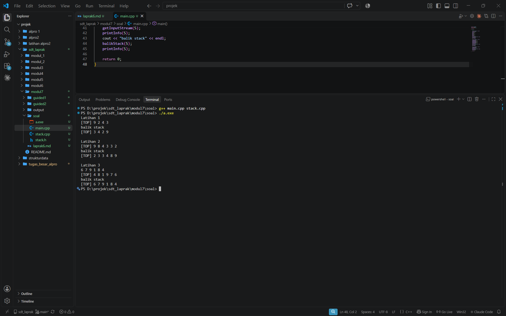
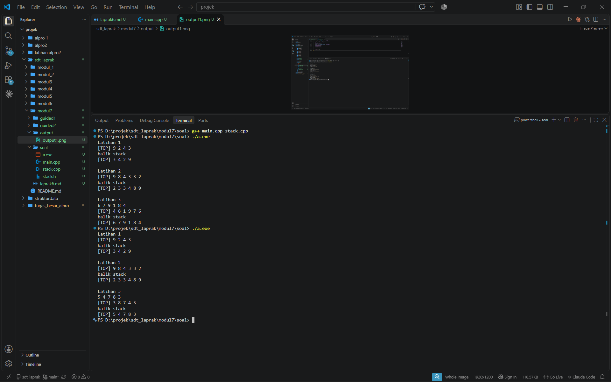

# <h1 align="center">Laporan Praktikum Modul 7 - STACK</h1>

<p align="center">Hassan Donny Darmawan - 109082500030</p>

## Dasar Teori

Bagian ini membahas konsep dasar yang digunakan dalam praktikum, mulai dari pengertian *stack*, struktur ADT *stack* dalam file `.h` dan `.cpp`, operasi dasar *push* dan *pop*, hingga representasi *stack* menggunakan tabel (*array*) serta operasi tambahan yang digunakan pada latihan.

---

### A. Stack<br/>

Sub-bagian ini membahas pengertian *stack*, komponen penyusunnya, dan cara deklarasi struktur datanya.

#### 1. Pengertian Stack

*Stack* (tumpukan) adalah salah satu bentuk struktur data yang prinsip operasinya seperti tumpukan. Seperti halnya tumpukan, elemen yang dapat diambil terlebih dahulu adalah elemen yang paling atas, yaitu elemen yang terakhir kali dimasukkan. Prinsip ini disebut LIFO (*Last In First Out*).

#### 2. Komponen Stack

Komponen pada *stack* pada dasarnya sama dengan komponen pada *singly linked list*, hanya saja akses pada *stack* hanya dapat dilakukan pada awal *stack*. Komponen-komponennya adalah:
- `Top`, yaitu *pointer* pada *stack* yang menunjuk ke elemen paling atas. `Top` merupakan satu-satunya komponen pada *stack* yang berfungsi untuk mengakses data.
- `info`, yaitu data yang disimpan pada setiap elemen.
- `next`, yaitu *pointer* pada elemen yang menunjuk ke elemen di bawahnya.

Pada kondisi kosong, `Top` bernilai `Nil`. Pada *stack* yang berisi elemen, `next` milik elemen terbawah bernilai `Nil`.

#### 3. Deklarasi Struktur Data

Struktur data *stack* dideklarasikan dengan `typedef` untuk tipe data informasi (`infotype`) dan `typedef struct elmStack *address;` agar `address` menjadi *pointer* ke `elmStack`. Kemudian dibuat `struct elmStack` yang berisi `info` bertipe `infotype` dan `next` bertipe `address`, serta `struct stack` yang hanya berisi `address Top`. Deklarasi dilengkapi dengan `#ifndef`, `#define`, dan `#endif` agar file *header* tidak ter-*include* berulang kali. Tipe `address` sama dengan tipe elemen pada *list* lainnya.

### B. ADT Stack<br/>

Sub-bagian ini membahas cara fungsi dasar *stack* disusun sebagai ADT dalam file `.h` dan `.cpp`.

#### 1. Pembagian File ADT

Seperti pada model *list* yang lain, semua fungsi dasar pada *stack* merupakan bagian dari ADT. Pada bahasa pemrograman C++, ADT tersebut disimpan dalam dua jenis file, yaitu file `*.h` yang berisi deklarasi tipe data dan *prototype* fungsi, serta file `*.cpp` yang berisi realisasi dari fungsi-fungsi tersebut. Fungsi `main()` ditulis pada file terpisah, yaitu `main.cpp`.

#### 2. Primitif dalam Stack

Primitif pada *stack* pada dasarnya sama dengan primitif pada *list* lainnya, tetapi jumlahnya lebih sedikit karena operasi hanya dilakukan terhadap elemen paling atas. Primitif yang digunakan adalah:
- `createStack(S)`, yaitu prosedur yang membentuk *stack* kosong.
- `isEmpty(S)`, yaitu fungsi yang memeriksa apakah *stack* kosong.
- `alokasi(x)`, yaitu fungsi yang membuat elemen baru berisi `x` dan mengembalikan alamatnya.
- `dealokasi(P)`, yaitu prosedur yang mengembalikan memori yang digunakan `P` ke sistem.
- Fungsi-fungsi pencarian dan fungsi primitif lainnya.

### C. Penambahan Elemen (Push)<br/>

Sub-bagian ini membahas operasi penyisipan elemen ke dalam *stack*. Pada representasi *pointer*, elemen `P` harus sudah dialokasikan sebelum disisipkan, yaitu dengan `P = alokasi(X);` lalu `P->next = Nil;`.

#### 1. Push pada Representasi Pointer

`push(P)` menyisipkan elemen beralamat `P` pada puncak *stack*. Operasi ini sama dengan *insert first* pada *list* biasa. Langkahnya adalah:
- `P->next = S.Top;`, yaitu `next` elemen baru diarahkan ke elemen yang sebelumnya berada di puncak.
- `S.Top = P;`, yaitu `Top` dipindahkan ke elemen baru.

Jika *stack* masih kosong, `S.Top` bernilai `Nil` sehingga `next` elemen baru otomatis bernilai `Nil`.

#### 2. Push pada Representasi Tabel

Pada representasi tabel, penyisipan dilakukan dengan menggeser indeks `Top` ke indeks berikutnya, kemudian data disimpan pada indeks tersebut. Langkahnya adalah:
- `Top = Top + 1;`, yaitu `Top` digeser ke indeks berikutnya.
- `S.info[Top] = X;`, yaitu data disimpan pada indeks `Top` yang baru.

Operasi ini hanya dapat dilakukan jika *stack* belum penuh, yaitu `Top` belum mencapai `Imax`.

### D. Penghapusan Elemen (Pop)<br/>

Sub-bagian ini membahas operasi pengambilan elemen dari *stack*.

#### 1. Pop pada Representasi Pointer

`pop` mengambil elemen pada puncak *stack* dengan syarat *stack* tidak kosong. Operasi ini mirip dengan *delete first* pada *list* linear, karena elemen yang pertama kali diakses adalah elemen paling atas. Langkahnya adalah:
- `P = S.Top;`, yaitu menyimpan alamat elemen puncak ke `P`.
- `S.Top = (S.Top)->next;`, yaitu memindahkan `Top` ke elemen di bawahnya.
- `return P;`, yaitu mengembalikan alamat elemen yang diambil.

#### 2. Pop pada Representasi Tabel

Pada representasi tabel, data pada indeks `Top` diambil terlebih dahulu, kemudian `Top` digeser ke indeks sebelumnya. Langkahnya adalah:
- `Temp = S.info[Top];`, yaitu menyimpan data pada indeks `Top` ke variabel sementara.
- `Top = Top - 1;`, yaitu menggeser `Top` ke indeks sebelumnya.

Data pada indeks `Top` yang lama tidak dihilangkan dari *array*, hanya saja sudah tidak dianggap sebagai bagian dari *stack* dan akan tertimpa saat terjadi *push* berikutnya.

### E. Stack Representasi Tabel<br/>

Sub-bagian ini membahas pengertian dan deklarasi *stack* yang menggunakan tabel.

#### 1. Pengertian Representasi Tabel

Pada prinsipnya, representasi menggunakan tabel sama dengan representasi *pointer*. Perbedaannya terletak pada pendeklarasian struktur datanya, yaitu menggunakan *array* berindeks sehingga jumlah tumpukan yang dapat disimpan terbatas. Indeks terbesar yang dapat digunakan disebut `Imax`. *Stack* dinyatakan kosong jika `Top = 0`.

#### 2. Deklarasi Struktur Data

Pada ADT *stack* representasi tabel dibuat `struct infotype` yang berisi data yang disimpan, misalnya `nim` dan `nama`. Kemudian dibuat `struct Stack` yang berisi `info`, yaitu *array* bertipe `infotype`, serta `Top` bertipe `int` sebagai penunjuk indeks elemen paling atas. Pada latihan, *array* dibuat berukuran 20 dengan tipe data `integer`. Karena indeks *array* pada C++ dimulai dari 0, kondisi kosong pada implementasi dapat dinyatakan dengan `Top = -1`.

#### 3. Primitif pada Representasi Tabel

Primitif pada representasi tabel pada dasarnya sama dengan representasi *pointer*. Perbedaannya hanya pada manajemen memori, yaitu pada representasi tabel tidak diperlukan `alokasi` dan `dealokasi`. Primitif yang digunakan adalah `createStack`, `isEmpty`, fungsi-fungsi pencarian, dan fungsi primitif lainnya.

### F. View dan Operasi Tambahan<br/>

Sub-bagian ini membahas operasi lain yang digunakan pada latihan selain *push* dan *pop*.

#### 1. View

`printInfo(S)` atau `viewStack(S)` menampilkan seluruh isi *stack* dengan menelusuri elemen mulai dari `Top` sampai elemen terbawah. Karena itu, elemen yang terakhir dimasukkan akan tampil paling awal.

#### 2. Balik Stack

`balikStack(S)` membalik urutan elemen pada *stack*, sehingga elemen yang semula berada di puncak berpindah ke dasar dan sebaliknya.

#### 3. Push Ascending

`pushAscending(S, x)` menyisipkan elemen `x` ke dalam *stack* sedemikian rupa sehingga isi *stack* selalu terurut. Elemen dengan nilai terbesar berada di puncak, sedangkan elemen dengan nilai terkecil berada di dasar.

#### 4. Input Stream

`getInputStream(S)` membaca *input* dari pengguna secara terus-menerus dan memasukkan setiap *input* ke dalam *stack* sampai pengguna menekan tombol *enter*. Pembacaan karakter dapat dilakukan dengan `cin.get()`.
---

## Guided 1

## stack.h
```C++
#ifndef STACK_TABLE
#define STACK_TABLE
#include <iostream>
using namespace std;
const int MAX = 10;

struct stackTable
{
    int data[MAX];
    int top;
};
bool isEmpty(stackTable s);
bool isFull(stackTable s);
void createStack(stackTable &s);
void push(stackTable &s, int angka);
void pop(stackTable &s); 
void update(stackTable &s, int posisi);
void view(stackTable s);
void searchData(stackTable s, int data);
#endif
```
## stack.cpp
```C++

#include "stack.h"
#include <iostream>
using namespace std;

bool isEmpty(stackTable s)
{
    return s.top == -1;
}
bool isFull(stackTable s)
{
    return s.top == MAX - 1;
}
void createStack(stackTable &s)
{
    s.top = -1;
}
void push(stackTable &s, int angka)
{

    if (isFull(s))
    {
        cout << "Stack penuh!" << endl;
    }
    else
    {
        s.top++;
        s.data[s.top] = angka;
        cout << "Data" << angka << "berhasil ditambahkan kedalam stack !" << endl;
    }
}

void pop(stackTable &s)
{
    if (isEmpty(s))
    {
        cout << "Stack kosong!" << endl;
    }
    else
    {
        int val = s.data[s.top];
        s.top--;
        cout << "Data" << val << " berhasil dihapus dari stack!" << endl;
    }
}

void update(stackTable &s, int posisi)
{
    if (isEmpty(s))
    {
        cout << "Stack kosong!" << endl;
    }
    if (posisi <= 0)
    {
        cout << "Posisi tidak valid!" << endl;
        return;
    }
    // index = top

    int idx = s.top - (posisi - 1);
    if (idx < 0 || idx > s.top)
    {
        cout << "Posisi " << posisi << " tidak valid!" << endl;
        return;
    }

    cout << "Update data posisi ke-" << posisi << endl;
    cout << "Masukkan angka : ";
    cin >> s.data[idx];
    cout << "Data berhasil diupdate!" << endl;
    cout << endl;
}

void view(stackTable s)
{
    if (isEmpty(s))
    {
        cout << "Stack kosong!" << endl;
    }
    else
    {
        for (int i = s.top; i >= 0; --i)
        {
            cout << s.data[i] << " ";
        }
    }
    cout << endl;
}

void searchData(stackTable s, int data)
{
    if (isEmpty(s))
    {
        cout << "Stack kosong!" << endl;
        return;
    }

    cout << "Mencari data " << data << "..." << endl;
    int posisi = 1;
    bool found = false;

    for (int i = s.top; i >= 0; --i)
    {
        if (s.data[i] == data)
        {
            cout << "Data " << data << " ditemukan pada posisi ke-" << posisi << endl;
            cout << endl;
            found = true;
            break;
        }
        posisi++;
    }

    if (!found)
    {
        cout << "Data " << data << " tidak ditemukan didalam stack!" << endl;
        cout << endl;
    }
}
```
## main.cpp
```C++
#include "stack.h"
#include <iostream>

using namespace std;

int main()
{
    stackTable s;
    createStack(s);

    push(s, 1);
    push(s, 2);
    push(s, 3);
    push(s, 4);
    push(s, 5);
    cout << endl;

    cout << "--- Stack setelah push ---" << endl;
    view(s);
    cout << endl;

    pop(s);
    pop(s);
    cout << endl;

    cout << "--- Stack setelah pop 2 kali ---" << endl;
    view(s);
    cout << endl;

    update(s, 2);
    update(s, 1);
    cout << endl;

    cout << "--- Stack setelah update ---" << endl;
    view(s);
    cout << endl;

    searchData(s, 4);
    searchData(s, 9);

    return 0;
}
```

## Penjelasan Kode
Program ini membuat *stack* dengan *array* yang dibagi menjadi tiga file, yaitu `stack.h`, `stack.cpp`, dan `main.cpp`. Di `stack.h` ada `struct stackTable` yang berisi `data` (*array* berukuran `MAX = 10`) dan `top` sebagai penunjuk elemen paling atas. Saat `top = -1`, artinya *stack* masih kosong. Di `stack.cpp` ada fungsi `isEmpty()` dan `isFull()` untuk mengecek kondisi *stack*, `createStack()` untuk mengosongkan *stack*, `push()` untuk menambah data di puncak, dan `pop()` untuk membuang data di puncak. Ada juga `update()` untuk mengganti isi data berdasarkan posisinya dari atas, `view()` untuk menampilkan isi *stack* dari puncak ke dasar, dan `searchData()` untuk mencari posisi suatu data.

Di `main()`, data 1 sampai 5 dimasukkan dengan `push()` sehingga `view()` menampilkan `5 4 3 2 1`. Setelah `pop()` dua kali, tampilannya menjadi `3 2 1`. Lalu `update()` dipakai untuk mengganti elemen posisi ke-2 dan ke-1 dengan angka yang diketik pengguna. Terakhir, `searchData()` mencari angka 4 dan 9, dan hasilnya bergantung pada angka yang dimasukkan saat `update()`, karena angka 4 sebelumnya sudah dibuang oleh `pop()`.

## Guided 2

## stack.h
```C++
#ifndef STACK
#define STACK
#define Nil NULL

#include <iostream>
using namespace std;
const int MAX = 10;

typedef struct node *address;

struct node
{
    int dataAngka;
    address next;
};

struct stack
{
    address top;
};

bool isEmpty(stack listStack);
void createStack(stack &listStack);
address alokasi(int angka);
void dealokasi(addresss &node);

void push(stack &listStack, address nodeBaru);
void pop(stack &listStack); 
void update(stack &listStack, int posisi);
void view(stack &listStack);
void searchData(stack listStack, int data);
#endif
```
## stack.cpp
```C++
#include "stack.h"
#include <iostream>

using namespace std;

bool isEmpty(stack listStack)
{
    if (listStack.top == Nil)
    {
        return true;
    }
    else
    {
        return false;
    }
}

void createStack(stack &listStack)
{
    listStack.top = Nil;
}

address alokasi(int angka)
{
    address nodeBaru = new node;
    nodeBaru->dataAngka = angka;
    nodeBaru->next = Nil;
    return nodeBaru;
}

void dealokasi(address &node)
{
    node->next = Nil;
    delete node;
}

void push(stack &listStack, address nodeBaru)
{
    nodeBaru->next = listStack.top;
    listStack.top = nodeBaru;
    cout << "Node " << nodeBaru->dataAngka << " berhasil ditambahkan kedalam stack!" << endl;
}

void pop(stack &listStack)
{
    address nodeHapus;
    if (isEmpty(listStack) == true)
    {
        cout << "Stack kosong!" << endl;
    }
    else
    {
        nodeHapus = listStack.top;
        listStack.top = listStack.top->next;
        nodeHapus->next = Nil;
        dealokasi(nodeHapus);
        cout << "node " << nodeHapus->dataAngka << " berhasil dihapus dari stack!" << endl;
    }
}

void update(stack &listStack, int posisi)
{
    if (isEmpty(listStack) == true)
    {
        cout << "Stack kosong!" << endl;
    }
    else
    {
        if (posisi == 0)
        {
            cout << "Posisi tidak valid!" << endl;
        }
        else
        {
            address nodeBantu = listStack.top;
            int count = 1;
            bool found = false;
            while (nodeBantu != Nil)
            {
                if (count < posisi)
                {
                    nodeBantu = nodeBantu->next;
                    count++;
                }
                else if (count == posisi)
                {
                    cout << "Update node poisisi ke-" << posisi << endl;
                    cout << "Masukkan angka : ";
                    cin >> nodeBantu->dataAngka;
                    cout << "Data berhasil diupdate!" << endl;
                    cout << endl;
                    found = true;
                    break;
                }
            }
            if (found == false)
            {
                cout << "Posisi " << posisi << " tidak valid!" << endl;
            }
        }
    }
}

void view(stack listStack)
{
    if (isEmpty(listStack) == true)
    {
        cout << "List kosong!" << endl;
    }
    else
    {
        address nodeBantu = listStack.top;
        while (nodeBantu != Nil)
        {
            cout << nodeBantu->dataAngka << " ";
            nodeBantu = nodeBantu->next;
        }
    }
    cout << endl;
}

void searchData(stack listStack, int data)
{
    if (isEmpty(listStack) == true)
    {
        cout << "List kosong!" << endl;
    }
    else
    {
        address nodeBantu = listStack.top;
        int posisi = 1;
        bool found = false;
        cout << "Mencari data " << data << "..." << endl;
        while (nodeBantu != Nil)
        {
            if (nodeBantu->dataAngka == data)
            {
                cout << "Data " << data << " ditemukan pada posisi ke-" << posisi << endl;
                found = true;
                cout << endl;
                break;
            }
            else
            {
                posisi++;
                nodeBantu = nodeBantu->next;
            }
        }
        if (found == false)
        {
            cout << "Data " << data << " tidak ditemukan didalam stack!" << endl;
            cout << endl;
        }
    }
}
```
## main.cpp
```C++
#include "stack.h"
#include <iostream>

using namespace std;

int main()
{
    stack listStack;
    address nodeA, nodeB, nodeC, nodeD, nodeE = Nil;
    createStack(listStack);

    nodeA = alokasi(1);
    nodeB = alokasi(2);
    nodeC = alokasi(3);
    nodeD = alokasi(4);
    nodeE = alokasi(5);

    push(listStack, nodeA);
    push(listStack, nodeB);
    push(listStack, nodeC);
    push(listStack, nodeD);
    push(listStack, nodeE);
    cout << endl;

    cout << "--- Stack setelah push ---" << endl;
    view(listStack);
    cout << endl;

    pop(listStack);
    pop(listStack);
    cout << endl;

    cout << "--- Stack setelah pop 2 kali ---" << endl;
    view(listStack);
    cout << endl;

    update(listStack, 2);
    update(listStack, 1);
    update(listStack, 4);
    cout << endl;

    cout << "--- Stack setelah update ---" << endl;
    view(listStack);
    cout << endl;

    searchData(listStack, 4);
    searchData(listStack, 9);

    return 0;
}
```
## Penjelasan Kode
Program ini membuat *stack* dengan *pointer* (*linked list*) yang dibagi menjadi tiga file, yaitu `stack.h`, `stack.cpp`, dan `main.cpp`. Di `stack.h` ada `struct node` yang berisi `dataAngka` dan `next`, serta `struct stack` yang hanya berisi `top` sebagai penunjuk elemen paling atas. Saat `top = Nil`, artinya *stack* masih kosong. Di `stack.cpp` ada `isEmpty()` untuk mengecek kondisi *stack*, `createStack()` untuk mengosongkan *stack*, `alokasi()` untuk membuat node baru, dan `dealokasi()` untuk menghapus node dari memori. Prosedur `push()` menyisipkan node di puncak dengan mengarahkan `next` node baru ke `top` yang lama lalu memindahkan `top` ke node baru, sedangkan `pop()` memindahkan `top` ke node di bawahnya lalu menghapus node yang lama. Ada juga `update()` untuk mengganti isi node berdasarkan posisinya dari atas, `view()` untuk menampilkan isi *stack* dari puncak ke dasar, dan `searchData()` untuk mencari posisi suatu data.

Di `main()`, lima node dengan nilai 1 sampai 5 dibuat dengan `alokasi()` lalu dimasukkan dengan `push()` sehingga `view()` menampilkan `5 4 3 2 1`. Setelah `pop()` dua kali, tampilannya menjadi `3 2 1`. Lalu `update()` dipanggil untuk posisi ke-2, ke-1, dan ke-4 dengan angka baru yang diketik pengguna, tetapi posisi ke-4 tidak valid karena isi *stack* tinggal tiga elemen. Terakhir, `searchData()` mencari angka 4 dan 9, dan hasilnya bergantung pada angka yang dimasukkan saat `update()`, karena angka 4 sebelumnya sudah dibuang oleh `pop()`.

## Unguided

### 1. ...

## stack.h
```C++
#ifndef STACK_H_INCLUDED
#define STACK_H_INCLUDED

#include <iostream>
using namespace std;

typedef int infotype;

struct Stack {
    infotype info[20];
    int top;
};

void createStack(Stack &S);
void push(Stack &S, infotype x);
infotype pop(Stack &S);
void printInfo(Stack S);
void balikStack(Stack &S);
void pushAscending(Stack &S, infotype x);
void getInputStream(Stack &S);

#endif
```
## stack.cpp
```C++
#include "stack.h"

void createStack(Stack &S) {
    S.top = -1;
}

void push(Stack &S, infotype x) {
    if (S.top == 19) {
        cout << "Stack penuh!" << endl;
    } else {
        S.top++;
        S.info[S.top] = x;
    }
}

infotype pop(Stack &S) {
    infotype x = -1;
    if (S.top == -1) {
        cout << "Stack kosong!" << endl;
    } else {
        x = S.info[S.top];
        S.top--;
    }
    return x;
}

void printInfo(Stack S) {
    cout << "[TOP] ";
    for (int i = S.top; i >= 0; i--) {
        cout << S.info[i] << " ";
    }
    cout << endl;
}

void balikStack(Stack &S) {
    int i = 0;
    int j = S.top;
    while (i < j) {
        infotype temp = S.info[i];
        S.info[i] = S.info[j];
        S.info[j] = temp;
        i++;
        j--;
    }
}

void pushAscending(Stack &S, infotype x) {
    if (S.top == 19) {
        cout << "Stack penuh!" << endl;
    } else {
        int i = S.top;
        while (i >= 0 && S.info[i] > x) {
            S.info[i + 1] = S.info[i];
            i--;
        }
        S.info[i + 1] = x;
        S.top++;
    }
}

void getInputStream(Stack &S) {
    char c = cin.get();
    while (c != '\n') {
        if (c >= '0' && c <= '9') {
            push(S, c - '0');
        }
        c = cin.get();
    }
}
```
## main.cpp
```C++
#include <iostream>
#include "stack.h"
using namespace std;

int main()
{
    Stack S;

    cout << "Latihan 1" << endl;
    createStack(S);
    push(S, 3);
    push(S, 4);
    push(S, 8);
    pop(S);
    push(S, 2);
    push(S, 3);
    pop(S);
    push(S, 9);
    printInfo(S);
    cout << "balik stack" << endl;
    balikStack(S);
    printInfo(S);
    cout << endl;

    cout << "Latihan 2" << endl;
    createStack(S);
    pushAscending(S, 3);
    pushAscending(S, 4);
    pushAscending(S, 8);
    pushAscending(S, 2);
    pushAscending(S, 3);
    pushAscending(S, 9);
    printInfo(S);
    cout << "balik stack" << endl;
    balikStack(S);
    printInfo(S);
    cout << endl;

    cout << "Latihan 3" << endl;
    createStack(S);
    getInputStream(S);
    printInfo(S);
    cout << "balik stack" << endl;
    balikStack(S);
    printInfo(S);

    return 0;
}
```

##### Output 1



##### Output 2



## Penjelasan Kode
Program ini menunjukkan cara menyimpan data angka ke dalam *stack* dengan representasi *array* dan penerapan konsep ADT yang dipisah menjadi tiga file, yaitu `stack.h`, `stack.cpp`, dan `main.cpp`. File `stack.h` berisi `typedef int infotype;` dan `struct Stack` yang menyimpan `info` berupa *array* berukuran 20 serta `top` sebagai penunjuk indeks elemen paling atas. Nilai `top = -1` menandakan *stack* kosong karena indeks *array* pada C++ dimulai dari 0. Selain itu, *header* berisi `#ifndef`, `#define`, dan `#endif` agar file tidak ter-*include* berulang kali, serta deklarasi tujuh prosedur dan fungsi, yaitu `createStack`, `push`, `pop`, `printInfo`, `balikStack`, `pushAscending`, dan `getInputStream`.

File `stack.cpp` berisi isi dari fungsi-fungsi tersebut. Prosedur `createStack()` mengisi `top` dengan `-1`. Prosedur `push()` menaikkan `top` lalu menyimpan `x` pada `info[top]`, dan mencetak `Stack penuh!` jika `top` sudah 19. Fungsi `pop()` mengambil nilai pada `info[top]`, menurunkan `top`, lalu mengembalikan nilai tersebut, dan mencetak `Stack kosong!` jika *stack* kosong. Prosedur `printInfo()` menelusuri *array* dari `top` mundur sampai indeks 0, sehingga elemen terakhir yang dimasukkan tampil paling awal. Prosedur `balikStack()` menukar isi *array* dari kedua ujung menuju tengah. Prosedur `pushAscending()` menggeser elemen yang lebih besar dari `x` satu indeks ke atas lalu menyisipkan `x`, sehingga nilai terbesar selalu berada di puncak. Prosedur `getInputStream()` membaca karakter dengan `cin.get()` sampai tombol *enter* ditekan, lalu setiap digit diubah menjadi angka dengan `c - '0'` dan dimasukkan dengan `push()`, sedangkan karakter lain seperti spasi diabaikan. Parameter `Stack &S` memakai tanda `&` (*call by reference*) pada prosedur yang mengubah *stack*, sedangkan `printInfo()` cukup dikirim dengan nilai karena isinya hanya dibaca.

Di dalam fungsi `main()`, `S` bertipe `Stack` dipakai bersama oleh ketiga latihan dan dikosongkan dengan `createStack(S)` di awal setiap latihan. Pada Latihan 1, program melakukan `push` 3, 4, 8, `pop`, `push` 2, 3, `pop`, lalu `push` 9, sehingga `printInfo()` menampilkan `[TOP] 9 2 4 3` dan setelah `balikStack()` menjadi `[TOP] 3 4 2 9`, sesuai dengan Gambar 7-11 pada modul. Pada Latihan 2, nilai 3, 4, 8, 2, 3, dan 9 dimasukkan dengan `pushAscending()` sehingga tampil `[TOP] 9 8 4 3 3 2` dan setelah dibalik menjadi `[TOP] 2 3 3 4 8 9`, sesuai dengan Gambar 7-13. Pada Latihan 3, dengan input `6 7 9 1 8 4`, data tampil sebagai `[TOP] 4 8 1 9 7 6` dan setelah dibalik menjadi `[TOP] 6 7 9 1 8 4`, sesuai dengan contoh pada Gambar 7-15, lalu program berakhir dengan `return 0;`.

````

````
## Kesimpulan

Berdasarkan Modul 7 dan latihan yang dikerjakan, dapat disimpulkan bahwa *stack* adalah struktur data yang bekerja dengan prinsip LIFO (*Last In First Out*), yaitu elemen yang terakhir dimasukkan menjadi elemen yang pertama kali diambil. Akses data hanya dilakukan lewat `Top`, dengan dua operasi utama, yaitu `push` untuk menambah elemen di puncak dan `pop` untuk mengambil elemen dari puncak. Pada representasi *pointer*, `push` dan `pop` sama dengan *insert first* dan *delete first* pada *singly linked list*, sedangkan pada representasi tabel keduanya dilakukan dengan menggeser indeks `Top` naik atau turun.

Pada latihan, ADT *stack* dibuat dengan *array* dalam tiga file, yaitu `stack.h`, `stack.cpp`, dan `main.cpp`. Dengan `top = -1` sebagai penanda *stack* kosong, `push` menaikkan `top` lalu menyimpan data, sedangkan `pop` mengembalikan data pada `top` lalu menurunkannya. `printInfo()` menampilkan isi dari puncak sehingga data yang terakhir masuk tampil paling awal, dan `balikStack()` membalik urutannya. `pushAscending()` menjaga isi *stack* tetap terurut dengan menggeser elemen yang lebih besar, sehingga nilai terbesar selalu berada di puncak, sedangkan `getInputStream()` memasukkan setiap angka yang diketik pengguna sehingga angka terakhir berada di puncak.

Dibandingkan representasi *pointer*, representasi tabel lebih sederhana karena tidak memerlukan `alokasi` dan `dealokasi`, tetapi kapasitasnya terbatas sehingga *stack* harus dicek penuh atau tidaknya sebelum `push`. Representasi *pointer* tidak dibatasi ukuran *array*, tetapi memori harus dikelola dan dibebaskan dengan benar. Pada keduanya, kondisi *stack* kosong perlu diperiksa sebelum `pop` agar tidak terjadi kesalahan akses data.

## Referensi

[1] Modul Praktikum Struktur Data — Modul 7: Stack, Fakultas Informatika, Telkom University.
<br>[2] Stroustrup, B. (2013). *The C++ Programming Language* (4th ed.). Addison-Wesley.
<br>[3] cplusplus.com. *Data Structures (struct)*. https://cplusplus.com/doc/tutorial/structures/
<br>[4] cplusplus.com. *Arrays*. https://cplusplus.com/doc/tutorial/arrays/
<br>[5] cplusplus.com. *Pointers*. https://cplusplus.com/doc/tutorial/pointers/
<br>[6] cplusplus.com. *Dynamic Memory*. https://cplusplus.com/doc/tutorial/dynamic/
<br>[7] cplusplus.com. *Functions*. https://cplusplus.com/doc/tutorial/functions/